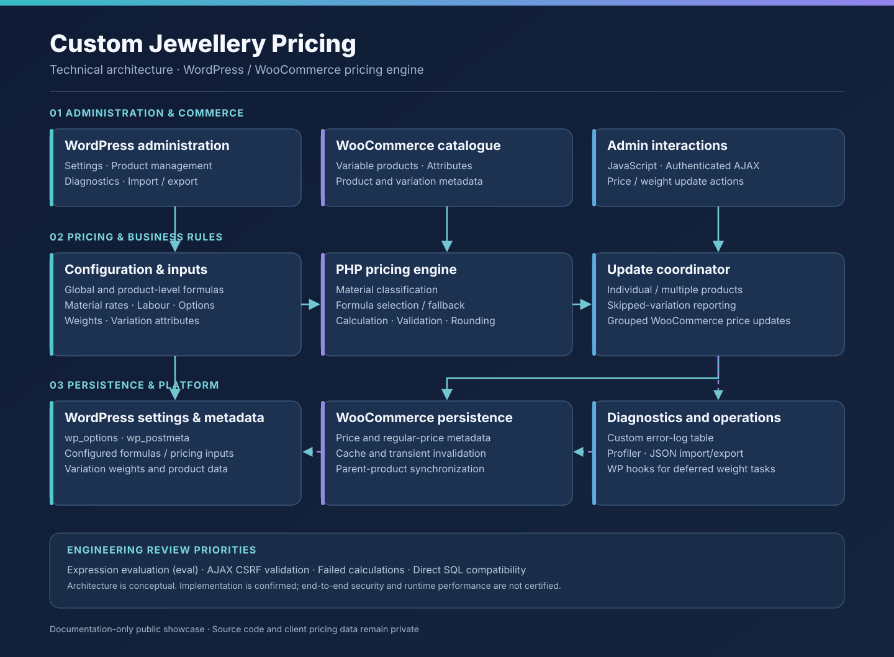
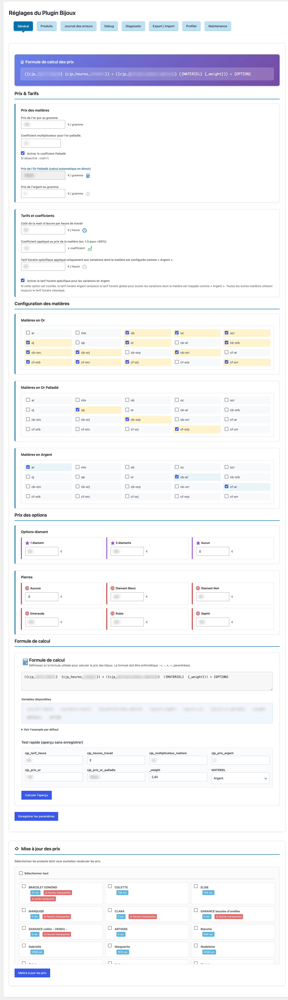
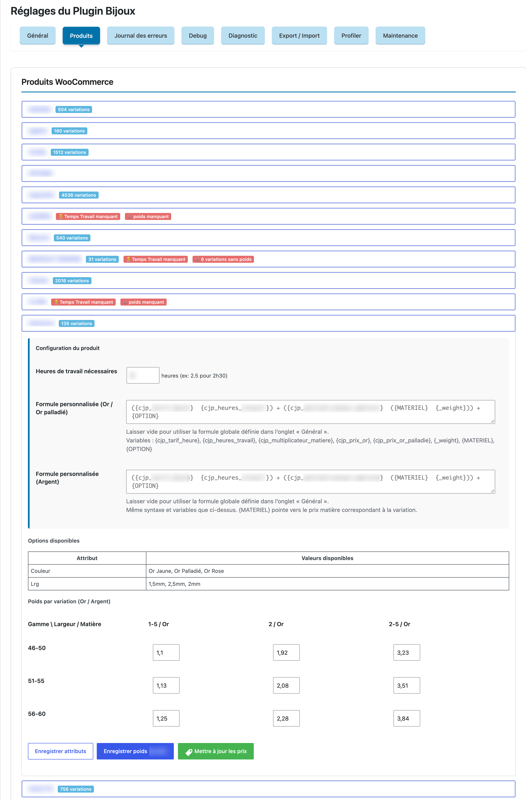

# Custom Jewellery Pricing

### Configurable Pricing Engine for WordPress & WooCommerce

**PHP · WordPress · WooCommerce · JavaScript · AJAX · MySQL**

A custom WordPress plugin that automates jewellery pricing with configurable formulas, material-specific calculations and WooCommerce product variations.

🇬🇧 English | [🇫🇷 Français](README.fr.md)

> Public technical case study only. The original plugin source code remains private.

---

## Project Overview

Jewellery pricing involves material costs, product weight, manufacturing time, hourly rates, pricing coefficients and optional components. The project addressed the need to update prices across multiple WooCommerce products, some containing up to **4,500 variations**, making manual price maintenance time-consuming and error-prone.

Custom Jewellery Pricing brings configurable calculation rules into WooCommerce administration and supports bulk recalculation of variation prices.

## My Role

**PHP Developer — Custom WordPress & WooCommerce Plugin Development**

This project highlights the development of business-specific PHP calculations, WooCommerce product integration, administration interfaces, AJAX price updates, diagnostics and performance-related improvements.

## Key Features

- **Configurable formulas:** a global formula and separate product-level gold/silver formulas, with fallback behavior.
- **Material-dependent pricing:** gold, silver and palladium-containing gold categories.
- **WooCommerce variation integration:** attributes and metadata contribute to each calculated price.
- **Individual and bulk recalculation:** AJAX administration actions for updating one or several products.
- **Input validation and error logging:** missing weight or labour data is flagged and logged.
- **Configuration portability:** selected settings can be exported or imported as JSON.
- **Diagnostics:** error logs, profiling tools and execution-time measurements.
- **Weight operations:** AJAX management and deferred processing using WordPress scheduled hooks.

## Technical Stack

| Area | Technologies |
|---|---|
| Back-end | PHP, WordPress plugin APIs |
| E-commerce | WooCommerce products, variations and metadata |
| Database | WordPress database API (`$wpdb`), MySQL |
| Administration | WordPress Settings API, PHP, JavaScript, AJAX |
| Background processing | WordPress scheduled hooks |
| Data exchange | JSON |
| Testing dependency | PHPUnit (configured as a development dependency; coverage not verified) |

## Architecture

The plugin integrates administration screens, a pricing calculation layer, product variation access, WooCommerce persistence and diagnostics. This diagram is conceptual and does not imply that every integration has been fully audited.

Read the [architecture case study](docs/architecture.md).

## Engineering Challenges

The main technical considerations include:

- Making product pricing rules flexible without hard-coding each variation.
- Determining relevant materials and values from heterogeneous attributes.
- Preventing updates when required product information is missing.
- Performing many price updates efficiently while keeping WooCommerce metadata and caches consistent.
- Securing configurable expressions and privileged administration actions.
- Validating long-running and deferred operations.

See [Technical Challenges & Engineering Decisions](docs/technical-challenges.md).

## Technical Documentation

- [Technical Architecture](docs/architecture.md) — WordPress/WooCommerce components and interactions.
- [Pricing Engine](docs/pricing-engine.md) — Business inputs, formula selection, variation processing and persistence.
- [Technical Challenges](docs/technical-challenges.md) — Trade-offs, validation priorities and possible improvements.

## Screenshots

### Global pricing configuration

This screen shows the plugin's global pricing configuration interface, including:

- configurable pricing formulas,
- material and coefficient settings,
- option pricing,
- formula test tools,
- and bulk price update actions.

### Product pricing management

This screen shows product-level pricing management for WooCommerce products, including:

- product variation volumes,
- product-specific pricing formulas,
- weight configuration,
- validation warnings for missing data,
- and direct price update actions.

## Confidentiality

This documentation does not include the private application source code, actual client prices, proprietary commercial settings or identifying customer information.
