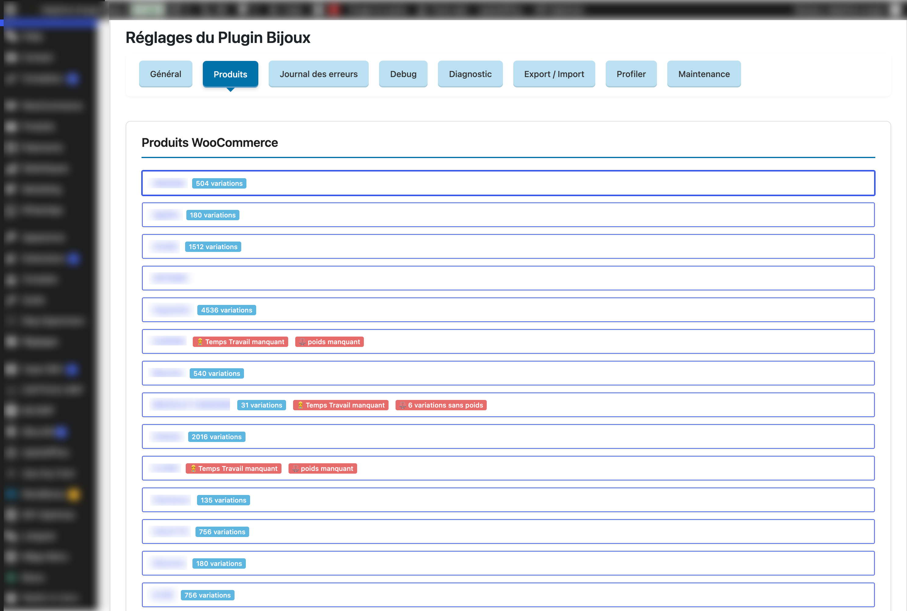

# Pricing Engine — Technical Case Study

## Overview

Custom Jewellery Pricing is a WordPress plugin that calculates WooCommerce product variation prices using configurable business rules.

The pricing engine combines product metadata, material information, labour costs, and optional components to determine selling prices.

Its main purpose is to reduce manual maintenance while supporting different pricing strategies across jewellery products.

This document describes the implementation concepts without exposing confidential production prices or customer-specific commercial rules.

---

## 1. Pricing Inputs

The engine uses several categories of input data.

| Input | Purpose |
|---|---|
| Material type | Determines which material pricing rules apply |
| Material weight | Determines the quantity of material involved |
| Material unit price | Provides the configured cost for a material |
| Labour time | Represents production time for a product |
| Hourly rate | Provides the configured labour pricing rate |
| Material multiplier | Applies an additional pricing coefficient |
| Diamond options | Adds configured option costs |
| Gemstone options | Adds configured gemstone costs |
| Pricing formula | Defines how the inputs are combined |

Some values are stored as WordPress options, while others come from WooCommerce products, variations, and custom metadata.

---

## 2. Configurable Formulas

### Global Formula

The plugin supports a global pricing expression used when no applicable product-specific formula is defined.

The implementation contains a default expression combining:

- Labour cost.
- Material cost.
- A configurable material multiplier.
- Additional options.

### Product-Specific Formulas

The application also supports distinct formulas for:

- Gold and palladium-containing gold.
- Silver.

The engine selects the applicable product formula based on the identified material type.

If the relevant product-specific formula is empty, it falls back to the global formula.

This enables product-level pricing customization without maintaining an independent calculation implementation for every item.

---

## 3. Material Classification

Product variations may contain material information in several attributes.

The plugin includes logic for identifying and normalizing material types.

Supported categories include:

- Gold.
- Silver.
- Palladium-containing gold.

When multiple material-related attributes are present, the implementation applies business rules to determine the resulting category.

A normalized material type may be stored as variation metadata for subsequent calculations.

This reduces repeated interpretation of raw variation attributes.

The classification process is an important part of the pricing engine because the selected material influences the calculation inputs and formula.

---

## 4. Variation Pricing Workflow

For a given WooCommerce variable product, the engine follows this general process:

1. Retrieve the product's relevant variation data.
2. Identify and normalize the material category.
3. Retrieve configured material prices and coefficients.
4. Retrieve the product's labour time and applicable hourly rate.
5. Collect relevant variation options, including gemstones and diamonds.
6. Select the applicable pricing formula.
7. Substitute the formula variables with numeric values.
8. Evaluate the arithmetic expression.
9. Apply rounding rules.
10. Prepare the resulting variation prices for persistence.

The engine can repeat this sequence across multiple variations belonging to the same product.

### Formula Selection

The selection logic follows this hierarchy:

| Material | Preferred formula | Fallback |
|---|---|---|
| Silver | Product-specific silver formula | Global formula |
| Gold | Product-specific gold formula | Global formula |
| Palladium-containing gold | Product-specific gold formula | Global formula |

The material category can also influence the numerical values used within the expression.

### Variation volume overview

This screen highlights the operational context of the plugin: some WooCommerce products contain several hundred to several thousand variations, with certain products reaching more than 4,500 variations.

This illustrates why manual price maintenance was impractical and why bulk calculation and update mechanisms were required.

---

## 5. Simplified Pricing Example

The following example is illustrative and uses fictional values.

It does not reproduce actual customer pricing rules.

Suppose a variation has:

| Parameter | Example |
|---|---:|
| Material weight | 5 g |
| Material unit price | €60/g |
| Material multiplier | 1.5 |
| Labour time | 2 hours |
| Hourly rate | €45/hour |
| Additional options | €30 |

A simplified expression would be:

`Price = (weight × material price × multiplier) + (labour time × hourly rate) + options`

Result:

`Price = (5 × 60 × 1.5) + (2 × 45) + 30`

`Price = €570`

The important architectural concept is not the example formula itself, but the ability to change the parameters and select formulas without modifying each WooCommerce variation manually.

---

## 6. Data Validation & Error Handling

A configurable pricing engine must not blindly calculate and persist every result.

The implementation contains checks for missing or invalid data.

### Missing Labour Time

The calculation function checks whether the required production time is available and greater than zero.

If not, it records an error and returns no calculated price.

### Missing Variation Weight

The batch calculation process skips variations with missing or non-positive weight and records a diagnostic event.

### Invalid Expressions

If formula evaluation fails, the current implementation can fall back to a predefined calculation.

These mechanisms aim to keep price updates resilient when product configuration is incomplete.

However, some edge cases, particularly the handling of unsuccessful calculations within a larger batch, require dedicated regression tests.

---

## 7. Bulk Price Updates

Processing many variations individually may lead to a large number of database operations.

The plugin includes a dedicated bulk-update mechanism that groups price changes into SQL statements.

The implementation updates the WooCommerce price metadata associated with variations, including:

- Current price.
- Regular price.

Missing metadata rows can be inserted when necessary.

After updating variation data, the plugin performs cache invalidation and synchronizes the parent variable product.

### Performance Trade-Off

Direct SQL can reduce the overhead associated with updating each variation through higher-level APIs.

However, it also introduces compatibility considerations.

In particular, direct writes to WordPress metadata bypass some WooCommerce object lifecycle mechanisms and require careful cache handling.

This approach should be assessed against WooCommerce's current data-storage and extension compatibility requirements.

---

## 8. Administration & AJAX Operations

The plugin exposes dedicated administration operations for recalculating prices.

### Single Product Update

An administrator can request an update for a specific variable product.

The response includes information such as:

- Number of updated variations.
- Number of skipped variations.
- Total variation count.
- Execution time.

### Multiple Product Update

The administration interface can also process a collection of selected products.

The response provides aggregate statistics and per-product details.

### Authorization

The AJAX endpoints check the `manage_woocommerce` capability.

Request validation and CSRF protection are important additional considerations, particularly because these operations can modify commercial pricing data.

---

## 9. Diagnostics & Performance Analysis

The plugin includes tools intended to help investigate processing cost.

The profiler can collect information about:

- Total execution duration.
- Number of SQL queries.
- Query execution times.
- Individual variation processing durations.
- Variation attributes associated with processing results.

This makes performance investigation part of the administration tooling rather than relying exclusively on external profiling tools.

These measurements remain diagnostic indicators and should not be interpreted as a validated performance benchmark without controlled testing.

---

## 10. Engineering Risks & Future Improvements

### Arithmetic Expression Evaluation

The current implementation filters expression content before evaluating it dynamically using PHP `eval()`.

This design deserves a dedicated security review.

A restricted arithmetic parser would offer a clearer execution boundary, more predictable validation, and easier unit testing.

### WooCommerce Data Consistency

Direct metadata updates should be assessed for compatibility with WooCommerce storage abstractions and lifecycle events.

### Request Security

State-changing AJAX operations should consistently enforce authorization and nonce verification.

### Failed Calculations

Batch processing should explicitly reject unsuccessful calculations rather than allow null values to enter price persistence logic.

### Large Catalogue Processing

Long-running HTTP requests can become unreliable as catalogues grow.

Chunked processing and background jobs are potential future improvements.

### Automated Testing

Useful test cases include:

- Material classification.
- Product-specific formula selection.
- Global formula fallback.
- Missing weight and labour data.
- Invalid expression handling.
- Price rounding.
- Recalculation of multiple variations.
- Cache synchronization and update consistency.

---

## Conclusion

Custom Jewellery Pricing illustrates the complexity that can exist behind seemingly simple e-commerce functionality.

A product's selling price is the result of several interconnected business rules, variable attributes, and configurable parameters.

The technical challenge lies in turning those rules into a pricing engine that is understandable, maintainable, efficient, and safe to use within an existing WooCommerce environment.

The project demonstrates practical work involving:

- PHP business logic.
- WordPress plugin architecture.
- WooCommerce product variations.
- Configurable calculation rules.
- Database operations and optimization.
- Administration interfaces.
- Diagnostics and error handling.

---

## Confidentiality

This document uses conceptual descriptions and fictional examples.

It does not disclose actual client tariffs, private product data, or proprietary source code.